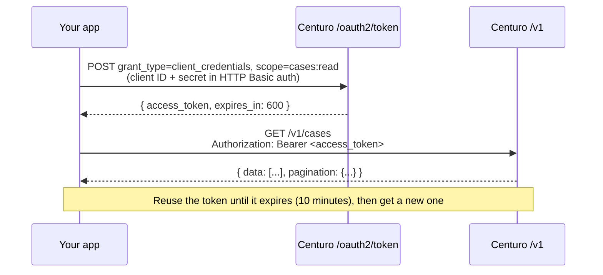

<div align="center">

# Centuro Global API quickstart

**Read your company's immigration and global mobility cases from your own systems, in a few lines of TypeScript.**

Clone this repo, add your API key, run `npm run me`, and you're connected.

[Quickstart](#quickstart) · [Use it in your code](#use-it-in-your-own-code) · [Endpoints](#endpoints) · [Postman](#postman) · [Errors](#errors) · [Troubleshooting](#troubleshooting)

</div>

---

## What's in here

| | |
|---|---|
| [`src/centuro.ts`](src/centuro.ts) | A small, typed client with no dependencies. Copy it into your own project. It gets and renews access tokens, pages through lists and turns errors into exceptions you can handle. |
| [`examples/`](examples) | Short scripts that each do one thing: check your key, list cases, read a case, page through everything. |
| [`postman/`](postman) | A Postman collection with a test for every endpoint, plus environments for QAT and local. |

## Quickstart

You need **Node.js 20.12 or later** and an **API key**. An API key is a client ID and a secret.

> **Getting a key.** During the pilot, your Centuro contact will send you a key for **QAT**, our test environment. Soon your company admins will be able to create keys themselves in the Centuro web app.

```bash
git clone https://github.com/Centuro-Global/centuro-api-quickstart.git
cd centuro-api-quickstart
npm install
cp .env.example .env
```

Open `.env` and paste in your client ID and secret:

```dotenv
CENTURO_CLIENT_ID=cg_...
CENTURO_CLIENT_SECRET=...
CENTURO_API_URL=https://qat-api-goglobal.centuroglobal.com
```

Then check it works:

```console
$ npm run me

✔ Connected to the Centuro API

  Company: Acme Ltd
  Key:     cg_7Hq2...
  Scopes:  cases:read
```

That's it. Now try the other examples:

| Command | What it does |
|---|---|
| `npm run me` | Shows your key, its scopes and your company. Run this first. |
| `npm run cases` | Lists your 10 newest live cases. |
| `npm run case -- <id>` | Shows one case in full. Take an `id` from `npm run cases`. |
| `npm run all-cases` | Pages through every live case and counts them by status. |
| `npm run case-types -- [search]` | Lists the kinds of case Centuro handles, e.g. `npm run case-types -- visa`. |
| `npm run test:postman` | Runs the Postman tests against the API using your `.env` key. |

## Use it in your own code

Copy [`src/centuro.ts`](src/centuro.ts) into your project. It has no dependencies: it only uses `fetch`, which is built into Node 18+, Deno and Bun.

```ts
import { CenturoClient, CenturoApiError } from "./centuro.js";

const centuro = new CenturoClient({
  clientId: process.env.CENTURO_CLIENT_ID!,
  clientSecret: process.env.CENTURO_CLIENT_SECRET!,
  apiUrl: "https://qat-api-goglobal.centuroglobal.com",
});

// One page
const page = await centuro.cases.list({ country: "DE", limit: 50 });

// Every case, fetching pages as you go
for await (const c of centuro.cases.all({ updatedAt: { gte: "2026-01-01" } })) {
  console.log(c.reference, c.applicant.name, c.standardisedStatus);
}

// One case, handling "not found"
try {
  const c = await centuro.cases.get("case_4f39d2ac-...");
} catch (error) {
  if (error instanceof CenturoApiError && error.code === "not-found") {
    // It doesn't exist, or it isn't your company's
  } else {
    throw error;
  }
}
```

The client:

- **Handles tokens for you.** It swaps your key for an access token on the first call, reuses the token, and gets a new one shortly before it expires.
- **Pages for you.** `.all()` returns an async iterator that follows `nextCursor` and fetches each page only when your loop reaches it.
- **Retries once** after a `401`, in case a token expired early, and after a `429`, waiting until the rate limit resets.
- **Throws `CenturoApiError`** for any error response. It has a `status`, a stable `code` to branch on, a readable `detail`, and a `requestId` to quote to us.
- Has `centuro.get(path, query)` for calling endpoints this file doesn't wrap yet.

## How authentication works

The API uses **OAuth 2.0 client credentials**. You never send your secret to the API itself. You swap it for a short-lived access token, then send the token with each request.



The same thing with `curl`:

```bash
TOKEN=$(curl -s -u "$CENTURO_CLIENT_ID:$CENTURO_CLIENT_SECRET" \
  -d grant_type=client_credentials -d scope=cases:read \
  https://qat-api-goglobal.centuroglobal.com/oauth2/token | jq -r .access_token)

curl -H "Authorization: Bearer $TOKEN" https://qat-api-goglobal.centuroglobal.com/v1/cases
```

> **Ask for the scopes you need.** A token only carries the scopes you put in `scope`, even if your key has more. If you leave one out, calls that need it return `403 insufficient-scope`. The client asks for `cases:read` by default. Set `CENTURO_SCOPES` to change that.

## Endpoints

Base URL: `https://qat-api-goglobal.centuroglobal.com`

| Method | Path | Scope | What it returns |
|---|---|---|---|
| `GET` | `/v1/me` | any | Your key, its scopes and your company |
| `GET` | `/v1/cases` | `cases:read` | Your company's cases (a list) |
| `GET` | `/v1/cases/{id}` | `cases:read` | One case |
| `GET` | `/v1/case-types` | any | The kinds of case Centuro handles (a list) |
| `GET` | `/v1/case-types/{id}` | any | One case type |

### Filtering cases

| Parameter | Example | Notes |
|---|---|---|
| `archived` | `true` | Default `false`, which returns live cases only |
| `country` | `DE` | ISO 3166 country code |
| `standardisedStatus` | `waiting_on_client` | The client-facing status |
| `createdAt[gte]`, `createdAt[lt]` | `2026-01-01` | ISO 8601 date or date-time |
| `updatedAt[gte]`, `updatedAt[lt]` | `2026-06-01T09:00:00Z` | ISO 8601 date or date-time |
| `sort` | `updatedAt` | `-createdAt` (the default: newest first) or `updatedAt` (oldest change first) |
| `limit` | `100` | 1 to 100. The default is 25. |
| `cursor` | | From `pagination.nextCursor` |

An unknown or misspelt parameter returns `400`. It is never silently ignored, so a typo can't quietly return every case.

### A case

```json
{
  "id": "case_4f39d2ac-c372-4103-a231-0bd701372f93",
  "reference": "5917",
  "caseType": "immigration_gm.business_visa",
  "country": "DE",
  "applicant": { "name": "Maria Example", "firstName": "Maria", "lastName": "Example", "title": null, "companyName": "Acme Ltd" },
  "standardisedStatus": "waiting_on_client",
  "stage": "awaiting_government_response",
  "startDate": "2026-03-01",
  "targetStartDate": "2026-04-01",
  "visaIssueDate": null,
  "visaExpiryDate": null,
  "archived": false,
  "createdAt": "2026-02-10T09:12:44Z",
  "updatedAt": "2026-11-09T16:03:10Z"
}
```

New status values and new fields may be added at any time. Make sure your code doesn't break when it meets one it doesn't know.

### Paging

Every list comes back in the same envelope:

```json
{
  "data": [ ... ],
  "pagination": { "nextCursor": "eyJhZnRlciI6...", "hasMore": true }
}
```

To get the next page, send `nextCursor` back as `cursor` and **keep the other parameters the same**. A cursor expires after 24 hours. Paging uses cursors, not page numbers, so you won't skip or repeat records when cases change while you're reading.

### Keeping your system in step

To sync cases into your own system, poll for changes:

1. Call `GET /v1/cases?sort=updatedAt&updatedAt[gte]=<last time you synced>`.
2. Page to the end and save each case.
3. Store the `updatedAt` of the last case you saw. Use it as `updatedAt[gte]` next time.

Using `gte` means you'll sometimes see the last case again. That's deliberate: it means you never miss one. Update by `id`, so seeing a case twice does no harm.

## Errors

Errors use [RFC 9457 problem details](https://www.rfc-editor.org/rfc/rfc9457) (`Content-Type: application/problem+json`):

```json
{
  "type": "https://developer.centuroglobal.com/errors/invalid-parameter",
  "title": "Invalid query parameter",
  "status": 400,
  "detail": "limit must be 1-100.",
  "requestId": "req_9974b3ae86c8424385948f6ae7824276",
  "errors": [{ "parameter": "limit", "message": "limit must be 1-100." }]
}
```

Branch on the last part of `type`. It never changes. The `title` and `detail` are for people and may be reworded.

| Status | Code | What it means |
|---|---|---|
| `400` | `invalid-parameter` | A parameter is wrong or unknown. `errors` says which one. |
| `400` | `cursor-expired` | The cursor is over 24 hours old. Start again without one. |
| `401` | `unauthorized` | No token, or the token has expired or been revoked. Get a new token. |
| `403` | `insufficient-scope` | It's yours, but your token lacks the scope. Ask for it in `scope`. |
| `404` | `not-found` | It doesn't exist, **or it belongs to another company**. These look the same on purpose. |
| `429` | `rate-limited` | Slow down. Wait for the number of seconds in `RateLimit-Reset`. |

**Rate limits.** Every response carries `RateLimit-Limit`, `RateLimit-Remaining` and `RateLimit-Reset` (seconds until the window resets). The limit is per key, per minute.

**Getting help.** Quote the `requestId`. It lets us find your exact request in our logs.

## Postman

The [`postman/`](postman) folder holds a collection with a request and tests for every endpoint. You don't need to manage tokens: the collection gets one with your key before the first request and renews it when it expires.

1. In Postman, choose **Import** and pick `postman/centuro-public-api.postman_collection.json` and `postman/qat.postman_environment.json`.
2. Select the **Centuro QAT** environment and fill in `clientId` and `clientSecret`. Put them in the **current value** column only, so they stay on your machine and aren't synced to your Postman workspace.
3. Send any request, or run the whole collection with the **Run** button to see the tests pass.

Or run the same tests from the command line with [Newman](https://github.com/postmanlabs/newman). It uses the key in your `.env`, so the secret is never written into a file:

```bash
npm run test:postman
```

## Environments

| Environment | `CENTURO_API_URL` | Use it for |
|---|---|---|
| **QAT** | `https://qat-api-goglobal.centuroglobal.com` | Building and testing your integration. The data is test data. |
| Production | *coming soon* | Your live integration. You'll need a separate production key. |

Keys only work in the environment they were created in.

## Troubleshooting

<details>
<summary><b><code>Set CENTURO_CLIENT_ID and CENTURO_CLIENT_SECRET in your .env file</code></b></summary>

You haven't created `.env`, or the values are empty. Run `cp .env.example .env` and fill it in. Run the commands from the repo's root folder, where `.env` lives.
</details>

<details>
<summary><b><code>401 Could not get an access token</code></b></summary>

The client ID or secret is wrong, or the key has been revoked. Check for spaces or quotes pasted in by mistake. The secret is only shown once, when the key is created. If you've lost it, ask for a new key.
</details>

<details>
<summary><b><code>400 invalid_scope</code> when getting a token</b></summary>

You asked for a scope your key wasn't given. Check `CENTURO_SCOPES`, or remove it to use the default (`cases:read`).
</details>

<details>
<summary><b><code>403 insufficient-scope</code></b></summary>

Your token doesn't carry the scope this endpoint needs. Add it to `CENTURO_SCOPES`, for example `CENTURO_SCOPES=cases:read`. If your key wasn't given that scope, ask for a key that has it.
</details>

<details>
<summary><b><code>404 not-found</code> for a case you can see in the Centuro web app</b></summary>

API keys belong to one company. Check `npm run me` shows the company you expect. Also check you're using the right environment: QAT and production hold different data.
</details>

<details>
<summary><b><code>process.loadEnvFile is not a function</code></b></summary>

Your Node.js is older than 20.12. Run `node --version`, then upgrade. If you use nvm, run `nvm use`.
</details>

## Keeping your key safe

- **Never commit `.env`.** It's already in `.gitignore`.
- Keep the secret on your server. Don't put it in a browser app or a mobile app.
- Use a separate key for each integration, so you can revoke one without breaking the others.
- If a secret leaks, revoke the key straight away and create a new one. Tokens it already issued stop working within 10 minutes.

## License

[MIT](LICENSE)
